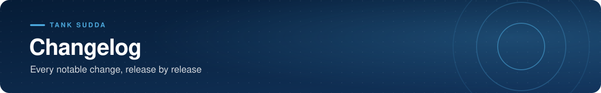

 

<strong>Every notable change to this project, newest first.</strong>

---

> [!NOTE]
> The format follows [Keep a Changelog](https://keepachangelog.com/en/1.1.0/) and the project uses [Semantic Versioning](https://semver.org/spec/v2.0.0.html). Each version links to its full comparison at the bottom of this page, and to its [release notes](https://github.com/saadmaz/Tank-Sudda-Website-TypeScript/releases).

## [Unreleased]

### Security

- Next.js upgraded from 16.4.3 to 16.4.6 to fix a known vulnerability. 16.4.3 now refuses to build, which blocked every deploy.

## [1.1.4] - 2026-11-17

### Changed

- Contributing, Security Policy, Code of Conduct, License and Changelog redesigned with branded headers, navigation, tables, diagrams and callouts; the licence is now LICENSE.md.

## [1.1.3] - 2026-11-17

### Changed

- README shows the development environment as awaiting host setup until development deploys are enabled.

## [1.1.2] - 2026-11-17

### Changed

- Redesigned README with a brand banner, live release, CI and deployment badges, action buttons, feature grid, diagrams and collapsible panels.
- Navigation bars and callouts across the contributing, security, conduct and documentation pages.

## [1.1.1] - 2026-11-17

### Fixed

- Production smoke test no longer fails when Cloudflare's bot protection challenges the CI runner; the challenge confirms the site is up.

## [1.1.0] - 2026-11-17

### Added

- Development and production environments: `develop` deploys to development and `main` to production, through one Deploy workflow and GitHub Environments with per-environment settings.

## [1.0.0] - 2026-11-16

First production release of [tanksudda.com](https://tanksudda.com) on Cloudflare Workers.

### Added

- Sinhala and Tamil versions of the core pages, with dedicated fonts and a language switcher.
- Designed booking notification emails for the sales team and an optional confirmation email for customers.
- Redesigned booking confirmation page.
- WhatsApp fallback when an online booking or contact submission cannot be delivered.
- Markdown versions of public pages, plus `llms.txt` and `llms-full.txt`.
- Google Analytics measurement.
- Technical illustrations, new knowledge-centre articles and a marketing kit in `docs/marketing/`.
- SEO plan, growth plan and DNS documentation.
- Continuous integration on every push and pull request: type check, lint, formatting, unit tests, production build and the full Playwright end-to-end and accessibility suite.
- Project governance: proprietary licence, security policy, contribution guidelines, code of conduct, issue forms, pull request template, CODEOWNERS and Dependabot.
- Standard documentation layout shared by every STTPS repository: architecture, configuration, deployment, decision records (ADRs) and release and rollback runbooks, indexed in `docs/README.md`.

### Changed

- Hosting moved to Cloudflare Workers via OpenNext, with email settings kept in `wrangler.jsonc`.
- Booking form simplified to three steps; booking requests go to both the sales and main inboxes.
- `info@tanksudda.com` is the public email address and sender.
- Tank Sudda logo used across the site, emails and search results.
- Redesigned homepage hero and simplified top contact bar.
- Font loading reworked for Sinhala and Tamil scripts, with long-term caching for static assets.
- Mobile layout refinements across the header, footer, sections and buttons.
- Upgraded Next.js to 16.4.3 for security fixes.

### Removed

- Vacuum cleaning service.
- Mobile action bar.

## [0.1.0] - 2026-10-12

### Added

- Complete rebuild of the Tank Sudda website on Next.js 16 with TypeScript, Tailwind CSS 4 and MDX.
- Services, pricing, areas, FAQ, about, contact, gallery and testimonials pages.
- Booking wizard and contact form with server-side validation, rate limiting and email or webhook delivery.
- Knowledge centre with categories, tags, search and guides.
- Verified phone, WhatsApp and email contact details.
- Unit tests and Playwright end-to-end and accessibility tests.

[Unreleased]: https://github.com/saadmaz/Tank-Sudda-Website-TypeScript/compare/v1.1.4...HEAD
[1.1.4]: https://github.com/saadmaz/Tank-Sudda-Website-TypeScript/compare/v1.1.3...v1.1.4
[1.1.3]: https://github.com/saadmaz/Tank-Sudda-Website-TypeScript/compare/v1.1.2...v1.1.3
[1.1.2]: https://github.com/saadmaz/Tank-Sudda-Website-TypeScript/compare/v1.1.1...v1.1.2
[1.1.1]: https://github.com/saadmaz/Tank-Sudda-Website-TypeScript/compare/v1.1.0...v1.1.1
[1.1.0]: https://github.com/saadmaz/Tank-Sudda-Website-TypeScript/compare/v1.0.0...v1.1.0
[1.0.0]: https://github.com/saadmaz/Tank-Sudda-Website-TypeScript/compare/v0.1.0...v1.0.0
[0.1.0]: https://github.com/saadmaz/Tank-Sudda-Website-TypeScript/releases/tag/v0.1.0
