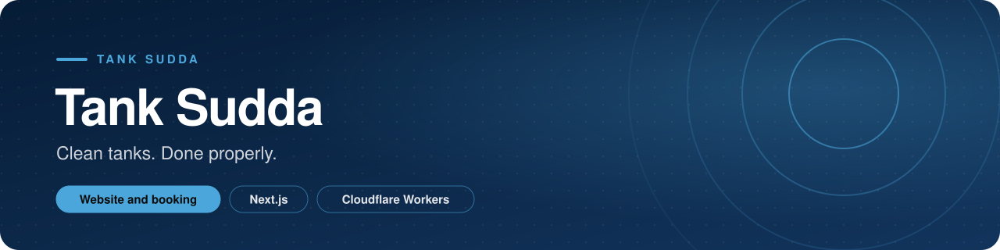
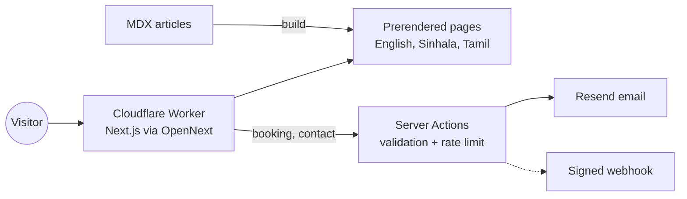
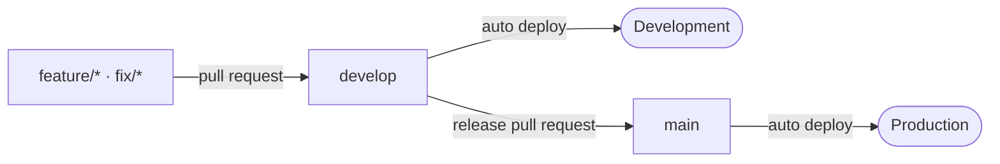

<a id="readme-top"></a>

<div align="center">



<br/><br/>

<p><strong>The website, knowledge centre and booking system for Tank Sudda, a professional water tank and sump cleaning service in Sri Lanka.</strong></p>

<a href="https://github.com/saadmaz/Tank-Sudda-Website-TypeScript/releases"></a>
<a href="https://github.com/saadmaz/Tank-Sudda-Website-TypeScript/actions/workflows/ci.yml"></a>
<a href="https://github.com/saadmaz/Tank-Sudda-Website-TypeScript/deployments"></a>
<a href="https://github.com/saadmaz/Tank-Sudda-Website-TypeScript/commits/develop"></a>


<br/><br/>

<a href="https://tanksudda.com"></a>
<a href="docs/README.md"></a>
<a href="https://github.com/saadmaz/Tank-Sudda-Website-TypeScript/issues/new?template=bug_report.yml"></a>
<a href="https://github.com/saadmaz/Tank-Sudda-Website-TypeScript/issues/new?template=feature_request.yml"></a>

<br/><br/>

<a href="#about">About</a> ·
<a href="#features">Features</a> ·
<a href="#architecture">Architecture</a> ·
<a href="#getting-started">Getting started</a> ·
<a href="#deployment">Deployment</a> ·
<a href="#documentation">Documentation</a> ·
<a href="#contributing">Contributing</a>

</div>

---

<details>
<summary><strong>Table of contents</strong></summary>

1. [About](#about)
2. [Features](#features)
3. [Architecture](#architecture)
4. [Tech stack](#tech-stack)
5. [Getting started](#getting-started)
6. [Configuration](#configuration)
7. [Project structure](#project-structure)
8. [Quality checks](#quality-checks)
9. [Deployment](#deployment)
10. [Documentation](#documentation)
11. [Releases and versioning](#releases-and-versioning)
12. [Contributing](#contributing)
13. [Security](#security)
14. [License](#license)

</details>

## About

Tank Sudda cleans domestic, commercial and institutional water tanks and sumps across Sri Lanka. This repository powers [tanksudda.com](https://tanksudda.com): service and pricing information, a knowledge centre on safe water storage, and online booking, in English, Sinhala and Tamil.

**Verified facts only.** The site never shows an unconfirmed phone number, price, area, review, photo or certification. Unknown values are stored as `null` and hidden in production; [docs/OWNER-CHECKLIST.md](docs/OWNER-CHECKLIST.md) lists what is still needed.

|                  |                                                                   |
| ---------------- | ----------------------------------------------------------------- |
| **Organisation** | Tank Sudda (Pvt) Ltd                                              |
| **Status**       | Live                                                              |
| **Website**      | [tanksudda.com](https://tanksudda.com)                            |
| **Contact**      | [info@tanksudda.com](mailto:info@tanksudda.com) · +94 74 100 4296 |
| **Maintainer**   | [Saad Mazhar](https://github.com/saadmaz)                         |

<p align="right"><a href="#readme-top">Back to top ↑</a></p>

## Features

<table>
<tr><td width="50%" valign="top"><strong>Services</strong><br/>Water tank deep cleaning, sump cleaning, and commercial and institutional tank cleaning, each with a step-by-step method.</td><td width="50%" valign="top"><strong>Booking wizard</strong><br/>A three-step booking request with server-side validation, rate limiting, branded notification emails and an optional customer confirmation email. Falls back to WhatsApp if delivery fails.</td></tr>
<tr><td width="50%" valign="top"><strong>Knowledge centre</strong><br/>MDX articles with categories, tags, search, curated guides, a table of contents and related content.</td><td width="50%" valign="top"><strong>Three languages</strong><br/>English, Sinhala (<code>/si</code>) and Tamil (<code>/ta</code>), each with its own fonts and root layout.</td></tr>
<tr><td width="50%" valign="top"><strong>Static first</strong><br/>Public pages are prerendered; only search and the booking acknowledgement render on request.</td><td width="50%" valign="top"><strong>SEO and AI readiness</strong><br/>Per-page metadata, JSON-LD, a generated sitemap, Markdown versions of every public page, and <code>llms.txt</code> / <code>llms-full.txt</code>.</td></tr>
<tr><td width="50%" valign="top"><strong>Accessibility</strong><br/>Automated axe checks, keyboard-friendly forms and WCAG AA contrast, covered by Playwright.</td><td width="50%" valign="top"><strong>Privacy-aware analytics</strong><br/>Google Analytics or Plausible, switched on by environment variable.</td></tr>
</table>

<p align="right"><a href="#readme-top">Back to top ↑</a></p>

## Architecture

A Next.js App Router application on Cloudflare Workers via OpenNext. Public pages are prerendered; booking and contact run as Server Actions with validation, rate limiting and email or webhook delivery. Business facts live in typed modules under `src/data` and articles in MDX.



> [!TIP]
> The full design, with every component and data flow, is in [docs/ARCHITECTURE.md](docs/ARCHITECTURE.md). Significant decisions are recorded as [architecture decision records](docs/adr/README.md).

<p align="right"><a href="#readme-top">Back to top ↑</a></p>

## Tech stack

<p>


</p>

<details>
<summary><strong>Full stack breakdown</strong></summary>

| Layer     | Technology                                                                       |
| --------- | -------------------------------------------------------------------------------- |
| Framework | [Next.js](https://nextjs.org) 16 (App Router, Server Components, Server Actions) |
| Language  | TypeScript (strict)                                                              |
| Styling   | Tailwind CSS 4                                                                   |
| Content   | MDX articles in `src/content/blog`                                               |
| Forms     | React Hook Form + Zod, shared by client and server                               |
| Email     | Resend, plus an optional signed webhook                                          |
| Hosting   | Cloudflare Workers via [OpenNext](https://opennext.js.org/cloudflare)            |
| Tooling   | Bun, Vitest, Playwright, axe-core, ESLint, Prettier                              |

</details>

<p align="right"><a href="#readme-top">Back to top ↑</a></p>

## Getting started

### Prerequisites

- Node.js 20.9 or later (22 LTS recommended)
- [Bun](https://bun.sh) 1.4 or later

### Install and run

```sh
git clone https://github.com/saadmaz/Tank-Sudda-Website-TypeScript.git
cd Tank-Sudda-Website-TypeScript
bun install
cp .env.example .env.local   # optional; see docs/CONFIGURATION.md
bun run dev                  # http://localhost:3000
```

<details>
<summary><strong>All scripts</strong></summary>

| Command                           | Description                                                                                                                  |
| --------------------------------- | ---------------------------------------------------------------------------------------------------------------------------- |
| `bun run dev`                     | Development server (drafts and unverified areas visible)                                                                     |
| `bun run build`                   | Production build                                                                                                             |
| `bun run start`                   | Serve the production build                                                                                                   |
| `bun run typecheck`               | Route type generation and `tsc --noEmit`                                                                                     |
| `bun run lint`                    | ESLint (Next.js core-web-vitals and TypeScript rules)                                                                        |
| `bun run format` / `format:check` | Format with Prettier, or check without writing                                                                               |
| `bun run test`                    | Unit tests (Vitest)                                                                                                          |
| `bun run test:e2e`                | End-to-end, link, 404 and axe accessibility tests (Playwright; build first, and run `bunx playwright install chromium` once) |
| `bun run check`                   | Type check, lint, unit tests and build                                                                                       |
| `bun run cf:preview`              | Build for Cloudflare and preview in the Workers runtime                                                                      |
| `bun run cf:deploy`               | Build for Cloudflare and deploy                                                                                              |

</details>

<p align="right"><a href="#readme-top">Back to top ↑</a></p>

## Configuration

Form delivery (Resend and an optional signed webhook), analytics, indexing and the canonical origin are set by environment variables. Non-secret values live in `wrangler.jsonc`; secrets are set in the Cloudflare dashboard.

<details>
<summary><strong>Environment variables</strong></summary>

| Variable                   | Effect                                                                                                                                                                         |
| -------------------------- | ------------------------------------------------------------------------------------------------------------------------------------------------------------------------------ |
| `NEXT_PUBLIC_SITE_URL`     | Verified production origin, e.g. `https://www.example.lk`. Enables canonical URLs, absolute Open Graph URLs, JSON-LD URLs, sitemap entries and `robots.txt` allowing crawlers. |
| `SITE_NOINDEX=1`           | Forces `noindex` + `Disallow: /` (use on staging/preview builds).                                                                                                              |
| `GOOGLE_SITE_VERIFICATION` | Adds the Search Console verification meta tag.                                                                                                                                 |

Where each value is set, and which are secret: [docs/CONFIGURATION.md](docs/CONFIGURATION.md).

</details>

> [!NOTE]
> Copy, business data, imagery and articles are edited as described in [docs/CONTENT.md](docs/CONTENT.md).

<p align="right"><a href="#readme-top">Back to top ↑</a></p>

## Project structure

<details>
<summary><strong>Repository layout</strong></summary>

```
.
├── .github/              # CI, issue and pull request templates
├── docs/                 # Architecture, configuration, deployment, content, ADRs, runbooks, plans
├── public/               # Static files
├── scripts/              # Article index, illustrations, email icons and brand asset generators
├── src/
│   ├── app/              # App Router: (en) English routes, (intl)/[lang] Sinhala and Tamil, metadata files
│   ├── components/       # Layout, page views, sections, booking and form components, SEO
│   ├── content/blog/     # Knowledge-centre articles in MDX
│   ├── data/             # Business facts, services, pricing, areas, FAQs and i18n dictionaries
│   ├── lib/              # Content loading, Markdown versions, SEO builders, validation, i18n
│   └── server/           # Server Actions, lead pipeline, notifications and rate limiting
├── tests/                # Vitest unit tests and Playwright end-to-end tests
├── open-next.config.ts   # OpenNext adapter configuration
└── wrangler.jsonc        # Cloudflare Workers configuration
```

</details>

<p align="right"><a href="#readme-top">Back to top ↑</a></p>

## Quality checks

Every pull request into `develop` or `main` runs the [CI workflow](.github/workflows/ci.yml): type check, lint, formatting, unit tests and a production build, followed by the full Playwright end-to-end and accessibility suite. Pull requests merge only when CI is green.

```sh
bun run lint && bun run format:check && bun run typecheck && bun run test && bun run build
bun run test:e2e
```

> [!IMPORTANT]
> Run the same checks locally before opening a pull request. They are the exact commands CI runs.

<p align="right"><a href="#readme-top">Back to top ↑</a></p>

## Deployment

| Environment | Branch    | URL                                            | Status                                                                                                                                                                          |
| ----------- | --------- | ---------------------------------------------- | ------------------------------------------------------------------------------------------------------------------------------------------------------------------------------- |
| Development | `develop` | [dev.tanksudda.com](https://dev.tanksudda.com) |  |
| Production  | `main`    | [tanksudda.com](https://tanksudda.com)         |     |



Cloudflare Workers Builds builds and serves each branch; the Deploy workflow verifies the build and the live URL. Environments, setup, secrets and post-deployment checks are in [docs/DEPLOYMENT.md](docs/DEPLOYMENT.md).

> [!TIP]
> To ship or undo a release, follow the [release](docs/runbooks/release.md) and [rollback](docs/runbooks/rollback.md) runbooks.

<p align="right"><a href="#readme-top">Back to top ↑</a></p>

## Documentation

Every STTPS repository uses the same documentation layout.

| Document                               | Covers                                               |
| -------------------------------------- | ---------------------------------------------------- |
| [Documentation index](docs/README.md)  | Every document in this repository                    |
| [Architecture](docs/ARCHITECTURE.md)   | How the system is built and how data flows           |
| [Configuration](docs/CONFIGURATION.md) | Environment variables and configuration files        |
| [Deployment](docs/DEPLOYMENT.md)       | Environments, hosting, pipeline and first-time setup |
| [Content](docs/CONTENT.md)             | Updating copy, business data, imagery and articles   |
| [Decision records](docs/adr/README.md) | Why the system is built the way it is                |
| [Runbooks](docs/runbooks/README.md)    | Release and rollback procedures                      |

<p align="right"><a href="#readme-top">Back to top ↑</a></p>

## Releases and versioning

[](https://github.com/saadmaz/Tank-Sudda-Website-TypeScript/releases)

The project follows [Semantic Versioning](https://semver.org). Every release is tagged `vX.Y.Z`, published on the [Releases](https://github.com/saadmaz/Tank-Sudda-Website-TypeScript/releases) page with its notes, and recorded in [CHANGELOG.md](CHANGELOG.md). The procedure is in [docs/runbooks/release.md](docs/runbooks/release.md).

<p align="right"><a href="#readme-top">Back to top ↑</a></p>

## Contributing

| Step |                                                                           |
| ---- | ------------------------------------------------------------------------- |
| 1    | Branch from `develop` using a type prefix (`feat/`, `fix/`, `docs/`, ...) |
| 2    | Commit with [Conventional Commits](https://www.conventionalcommits.org)   |
| 3    | Open a pull request into `develop` and complete the checklist             |
| 4    | Squash and merge once CI is green and the change is reviewed              |

The full guide is in [CONTRIBUTING.md](CONTRIBUTING.md). Everyone taking part follows the [Code of Conduct](CODE_OF_CONDUCT.md).

<p align="right"><a href="#readme-top">Back to top ↑</a></p>

## Security

> [!IMPORTANT]
> Never report a vulnerability in a public issue. Follow [SECURITY.md](SECURITY.md) to report it privately; you will hear back within three business days.

<p align="right"><a href="#readme-top">Back to top ↑</a></p>

## License

Copyright © 2026 Tank Sudda (Pvt) Ltd. All rights reserved.

This is proprietary software. The source is publicly visible, but no permission is granted to use, copy, modify or distribute it without prior written consent. See [LICENSE](LICENSE).

<div align="center">
<br/>
<sub>Built and maintained by the Tank Sudda team · Part of the <a href="https://sttps.co">STTPS group</a></sub>
</div>
